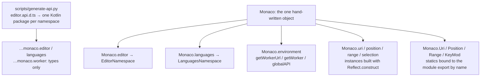

# API overview

The declarations follow `editor.api.d.ts` closely: same names, same members, one Kotlin package per
upstream namespace. This page explains the shapes that need a rule — the ones where Kotlin cannot
copy TypeScript literally — plus where to find each kind of declaration.

## Packages

| Kotlin package | Upstream | Files |
| --- | --- | --- |
| `io.github.shijianjs.ktjs.monaco` | the module's own exports and the `Monaco` entry | `Monaco.kt`, `MonacoModule.kt`, `root/*` |
| `…monaco.editor` | `namespace editor` | `Editor*.kt` |
| `…monaco.languages` | `namespace languages` | `Languages*.kt` |
| `…monaco.worker` | `namespace worker` (types only) | `WorkerTypes.kt` |

Inside a namespace package the files are split by declaration kind — `…Types` (interfaces), `…Classes`,
`…Enums`, `…Unions`, `…Literals` (string-literal unions), `…Namespace` (the namespace's own functions
and constants). A file name tells you what kind of declaration you are looking at.

`worker` has no runtime value: upstream declares types there and exports nothing under that name, so
`Monaco` has no `worker` accessor and `WorkerTypes.kt` holds the types a worker context is written
against.



## The `Monaco` entry point

`Monaco` is the one hand-written object; everything else is generated.

```kotlin
Monaco.editor      // EditorNamespace: create, setTheme, setModelMarkers, tokenize, …
Monaco.languages   // LanguagesNamespace: register, registerCompletionItemProvider, …
Monaco.environment // the global MonacoEnvironment hook (getWorkerUrl / getWorker / globalAPI)
```

`Monaco.editor`, `Monaco.languages` and the five value classes are getters onto the module's named
exports (`@JsModule("monaco-editor")` + `@JsName("editor")`), so they are the package's objects,
not copies.

## Value classes

`Uri`, `Position`, `Range`, `Selection` and `KeyMod` are exported as **values**: they have statics
(`Uri.parse`, `Range.fromPositions`, `KeyMod.CtrlCmd`) and constructors. Kotlin's `@JsModule` on a
class imports a module's *default* export, which the package does not have, so those classes are
declared as two interfaces:

- `Uri` — the instance type (the members of an existing URI);
- `UriStatics` — the static members, bound to the module export by name in `root/RootModule.kt` and
  reached as `Monaco.Uri`.

Construction needs a call to the real constructor. `Monaco` provides the four factories:

```kotlin
val uri = Monaco.uri("file:///src/main.kt?x=1#frag")   // Monaco.Uri.parse
val position = Monaco.position(1.0, 1.0)               // new Position(1, 1)
val range = Monaco.range(1.0, 1.0, 3.0, 5.0)           // new Range(1, 1, 3, 5)
val selection = Monaco.selection(1.0, 1.0, 3.0, 5.0)   // new Selection(1, 1, 3, 5)
```

They build the instance through `Reflect.construct`, because an `external class` cannot be
instantiated with `new` unless it imports its module — and none of these can. `KeyMod` has no
instance members upstream, so it declares statics only.

## Literal unions

`theme`, `severity`, render types, `SelectionDirection` and the rest are string (or number)
literals in TypeScript. Each becomes a `sealed external interface` with a factory that wraps a
`String`/`Double`, plus a constants object:

```kotlin
theme = BuiltinThemes.vs              // "vs"
theme = BuiltinThemes.vsDark          // "vs-dark"; camelled, so no backticks
severity = MarkerSeveritys.Error      // 8
direction = SelectionDirections.LTR   // 0
```

Constants are runtime values of the upstream kind — a `String` or a `Double` — while the type stays
checked. A hyphen or another character Kotlin cannot put in an identifier is camel-cased in the
constant name only; the string it carries is untouched. Use the same-named factory
(`BuiltinTheme("solarized-dark")`) for a value the upstream list does not enumerate: monaco accepts
any theme name that was registered with `defineTheme`.

## Unions of types

A union like `string | IMarkdownString` or `Promise<Worker> | Worker` becomes one opaque
`external interface` with one factory per branch:

```kotlin
// IMarkdownStringOrString, StringOrDouble, PromiseWorkerOrWorker, …
val message = IMarkdownStringOrString("plain text")
val contents = IMarkdownStringOrString(unsafeJso<IMarkdownString> { value = "**bold**" })
```

A union that contains `any`/`unknown` collapses to `JsAny` instead, since nothing is narrowed there
anyway.

## Optional members and methods

- An optional property is `var x: T?`; "not set" is `undefined`, which reads back as `null`.
- An optional *method* (`getWorkerUrl?(id: string, label: string): string`) becomes a nullable
    function property, `var getWorkerUrl: ((String, String) -> String)?`. That is what lets a
    literal supply just one of them:

    ```kotlin
    Monaco.environment = unsafeJso<Environment> {
        getWorkerUrl = { _, _ -> "editor.worker.js" }
    }
    ```

- A required method stays a `fun`, so a wrong argument is a compile error.

## Namespaces as interfaces

`monaco.editor` is an object at runtime whose members are functions and constants. It is declared as
`external interface EditorNamespace` and reached through `Monaco.editor`, so a call reads like the
upstream one: `Monaco.editor.getModels()`, `Monaco.languages.getLanguages()`.

## Objects and callbacks

- Build object literals with `js.objects.unsafeJso<T> { … }`: every property is checked against
  `T`. Do not use `js("{…}")`.
- Callbacks are Kotlin function types (`(String) -> Unit`), promises are `kotlin.js.Promise`, arrays
  are `Array<T>`, sets are `js.collections.JsSet`, records are `js.objects.Record`.
- DOM parameters use `kotlin-browser`'s `web.html.*` / `web.dom.*` types, never `org.w3c.dom.*`.

## Regenerating

```bash
python scripts/generate-api.py            # writes the declarations
python scripts/generate-api.py --report    # prints the statistics and the skipped list
```

The script is the source of truth for the generated files; they all carry a
`// Generated by scripts/generate-api.py` header. [Development](https://github.com/shijianjs/ktjs-monaco-editor/tree/main/docs/development)
records the decisions behind the shapes above, and `docs/development/coverage.md` lists every
declaration, its status and the declarations left out with the reason.
