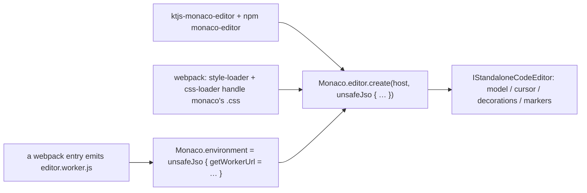

# Getting started

Three things have to be true before an editor appears: the dependency is on the classpath, the
bundler handles monaco's CSS, and the project points monaco at its worker. The first is Gradle, the
other two depend on your bundler.

## Requirements

- Kotlin/JS with `kotlin-browser` (the wrapper's types refer to `web.html.*`, `web.workers.*`).
- A bundler that can emit workers: the Kotlin/JS webpack integration does.
- JDK 21 is enough for the wrapper's own build.

## Dependency

```kotlin
dependencies {
    implementation("io.github.shijianjs:ktjs-monaco-editor:0.57.0-kt.1")
    // Added by the wrapper's published POM; listed here so the version is visible.
    implementation(npm("monaco-editor", "0.57.0"))
    // The two loaders monaco's stylesheets need (see "Bundler" below).
    devNpm("css-loader", "6.11.0")
    devNpm("style-loader", "4.0.0")
}
```

The module publishes as `ktjs-monaco-editor`, versioned `{upstream npm version}-kt.{revision}`. The
`npm("monaco-editor", …)` dependency comes with the POM, so a consumer only has to keep the version
in step when it pins one itself.



## The first editor

```kotlin
import io.github.shijianjs.ktjs.monaco.Monaco
import io.github.shijianjs.ktjs.monaco.editor.IStandaloneEditorConstructionOptions
import js.objects.unsafeJso
import web.dom.document
import web.html.HtmlTagName

fun main() {
    val host = document.createElement(HtmlTagName.div).apply {
        // monaco measures its container, so it needs a real size.
        style.width = "100%"
        style.height = "480px"
    }
    document.body.append(host)

    val editor = Monaco.editor.create(
        host,
        unsafeJso<IStandaloneEditorConstructionOptions> {
            value = "fun main() { println(\"Hello, Kotlin/JS\") }"
            language = "kotlin"
            automaticLayout = true
        },
    )
}
```

`Monaco.editor.create` returns `IStandaloneCodeEditor`: the model, the cursor, decorations and
markers all hang off it. `unsafeJso<...> { }` is the object-literal builder — each property is
checked against the upstream interface, so a misspelled option is a compile error instead of a
silently ignored one.

The package entry registers every built-in language, so `language = "kotlin"` is enough for syntax
highlighting. Language *services* (completions, diagnostics) additionally need a worker; the editor
and its Monarch grammars do not.

## Bundler

`monaco-editor` ships its stylesheets as ESM `import "./x.css"` statements and its icons as
`url(...)` references. Neither is something webpack handles by default, so a project that pulls the
package in declares two rules:

```javascript
// webpack.config.d/monaco-css.js — read from the module directory by the Kotlin/JS webpack tasks.
config.module.rules.push({
    test: /\.css$/,
    use: ["style-loader", "css-loader"],
    include: /node_modules[\\/]monaco-editor[\\/]/,
})
config.module.rules.push({
    test: /\.(woff2?|ttf|eot|svg)$/,
    type: "asset/resource",
})
```

This repository keeps that file in two places — the wrapper module (for its Karma test bundle) and
the demo (for the page bundle) — and both copies are identical. The wrapper cannot do it for you:
which loader runs is the consumer's bundler configuration.

## Workers

`monaco-editor` 0.57 starts its language service worker with
`new URL('…/editor.worker.js?esm', import.meta.url)`, a Vite-shaped pattern webpack cannot resolve;
without an answer from the project, the page logs `Failed to fetch dynamically imported module` and
features that depend on the worker stay silent. Two steps fix it:

1. Emit the worker as its own bundle. In webpack:

   ```javascript
   // webpack.config.d/monaco-worker.js
   config.entry["editorWorker"] = {
       import: require.resolve("monaco-editor/editor/editor.worker.js"),
       filename: "editor.worker.js",
   }
   ```

   The specifier goes through the package's `exports` map, which maps `./*` to `./esm/vs/*.js`, so
   it is written without the `esm/vs/` prefix that the file has on disk.

2. Point monaco at it, before the first editor is created:

   ```kotlin
   Monaco.environment = unsafeJso<Environment> {
       getWorkerUrl = { _, _ -> "editor.worker.js" }
   }
   ```

   `getWorkerUrl` receives the worker id and the label; every built-in language shares
   `editor.worker.js`. monaco wraps the URL in `new Worker(url, { type: "module" })`, which is why
   the emitted chunk is a plain bundled script. If your bundler can build one worker per language
   (`json`, `css`, `typescript`, `html`), return a different file per label instead.

The demo does exactly this; [Demo](demo.md) shows the page it produces.

## Verifying a build

```bash
./gradlew :ktjs-monaco-editor:jsBrowserTest   # the wrapper's own Chromium tests
./gradlew :demo:e2eTest                       # the demo page, through Playwright
```

The wrapper's tests run in Chromium through Karma, so they check the real package rather than a
mock: a wrong `@JsName`, a dropped member or a wrong value type fails there. The demo's suite runs
against the production bundle, which is the only place where bundling problems (CSS, workers) show
up.
