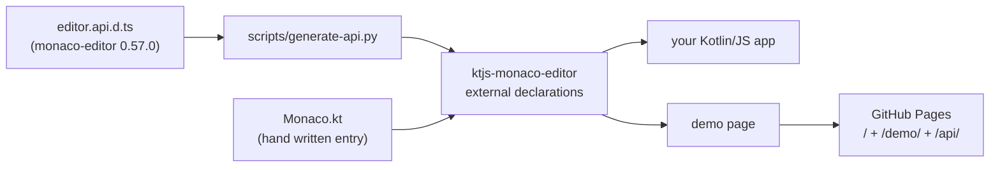

# Introduction

`ktjs-monaco-editor` is a Kotlin/JS wrapper for [`monaco-editor`](https://www.npmjs.com/package/monaco-editor),
the editor behind VS Code. It wraps the package's own ESM API — the same objects a TypeScript
consumer gets — into `external` Kotlin declarations checked at compile time, so an editor is built
from typed calls rather than from `dynamic`.

The wrapper tracks `monaco-editor` `0.57.0` and is generated from the package's declaration file:
[`editor.api.d.ts`](https://github.com/microsoft/monaco-editor/blob/main/src/editor/editor.api.d.ts).
`scripts/generate-api.py` reads that file and writes the declarations, so an upstream release is an
upstream bump plus a regeneration — see
[Development](https://github.com/shijianjs/ktjs-monaco-editor/tree/main/docs/development).

**[Live demo](https://shijianjs.github.io/ktjs-monaco-editor/demo/)** ·
**[API reference](https://shijianjs.github.io/ktjs-monaco-editor/api/)** — the same deployment,
three artifacts.

## What the wrapper covers

| Part | What it maps to |
| --- | --- |
| `Monaco.editor` | `monaco.editor`: creating editors, models, themes, markers, tokenisation |
| `Monaco.languages` | `monaco.languages`: registering languages, providers, and Monarch grammars |
| `Monaco.Uri`, `Monaco.Position`, `Monaco.Range`, `Monaco.Selection`, `Monaco.KeyMod` | the classes the package exports as values, their statics plus the [`Monaco.uri`/`position`/`range`/`selection`](guide/api-overview.md#value-classes) factories |
| `io.github.shijianjs.ktjs.monaco.{root,editor,languages,worker}` | the declared types, one Kotlin package per upstream namespace |
| `Monaco.environment` | the global `MonacoEnvironment` hook monaco reads before it starts a language service worker |

Everything monaco types in `editor.api.d.ts` is declared: 300 interfaces, 17 classes, 48 enums,
37 type aliases, 76 functions and constants. The handful of declarations the wrapper deliberately
leaves out, and why, are listed in
[coverage](https://github.com/shijianjs/ktjs-monaco-editor/blob/main/docs/development/coverage.md).

## What a wrapper is here

An npm package's types are erased at runtime; the wrapper's job is to keep them. So:

- A TypeScript `interface` becomes an `external interface` in Kotlin, with the same member names.
  It costs nothing at runtime and is checked when a `unsafeJso<...> { }` literal sets a member.
- A TypeScript union of literals becomes `sealed external interface X` plus a factory `X(String)`
  and a `Xs` object of named constants — the shape `kotlin-wrappers` uses, so `BuiltinThemes.vs` is
  a `String` at runtime but a checked type at compile time.
- A union of types becomes one opaque `external interface` with one factory per branch, e.g.
  `MarkerSeverity` is a number upstream and each branch is a same-named factory here.
- `any`, `unknown` and `object` become `JsAny`, the only members that are not statically narrowed.
  Each of them is a comment away from an explanation of why.

## Next steps

- [Getting started](guide/getting-started.md) — the dependency, a first editor, the bundler rules
  monaco needs.
- [API overview](guide/api-overview.md) — how the declarations are organised and how to read them.
- [Demo](guide/demo.md) — what the live page calls and what each call shows.

## How the pieces fit together

