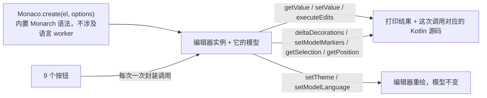

# 演示

在线页面在 **[https://shijianjs.github.io/ktjs-monaco-editor/demo/](https://shijianjs.github.io/ktjs-monaco-editor/demo/)**。
它就是本仓库的 `demo` 模块：一个 Kotlin/JS 页面，通过封装创建真实编辑器，并把封装的几个调用做成按钮。


每个按钮既打印做了什么，也打印做这件事的 Kotlin 调用，所以这一页本身就是封装的速查表。

## 页面展示了什么

编辑器里是一个小 Kotlin 文件，由 monaco 内置的 Monarch 语法高亮——不涉及语言服务 worker，
所以按[快速开始](getting-started.md) 配好的任何打包环境都能跑。

每个按钮执行一次封装调用，并打印结果和这次调用对应的 Kotlin 源码：

| 按钮 | 调用 | 展示内容 |
| --- | --- | --- |
| 读取文本 | `editor.getValue()` | 编辑器背后的模型 |
| 替换文本 | `editor.setValue(…)` | 通过模型写入 |
| 插入一行 | `editor.executeEdits("demo", arrayOf(unsafeJso<IIdentifiedSingleEditOperation> { … }))` | 一次编辑操作，用的是 `Monaco.range` 造的 `Range` |
| 高亮第 3 行 | `editor.deltaDecorations(previous, arrayOf(unsafeJso<IModelDeltaDecoration> { … }))` | 装饰及其 id |
| 添加警告标记 | `Monaco.editor.setModelMarkers(model, "ktjs-demo", arrayOf(unsafeJso<IMarkerData> { … }))` | 用 `MarkerSeveritys.Warning` 造的标记，并用 `getModelMarkers` 读回 |
| 查看选区 | `editor.getSelection()` | 一个 `Selection` 及其锚点/活动端 |
| 查看光标 | `editor.getPosition()` | 一个 `Position` |
| 切换主题 | `Monaco.editor.setTheme(…)` | 在 `BuiltinThemes` 之间切换 |
| 切换语言 | `Monaco.editor.setModelLanguage(model, …)` | 重新分词已有的模型 |

右上角的语言开关会重刷所有控件文案——英文与中文——同时保留编辑器实例、模型和光标。这是 demo 自己的
本地化，不是封装的：所有文案都是实现同一个 `Strings` 接口的普通 Kotlin 对象，漏翻一条就是编译错误。

## 本地运行

```bash
./gradlew :demo:jsBrowserDevelopmentRun   # 带热重载的开发服务器，http://localhost:8080
./gradlew :demo:jsBrowserDistribution     # 生产 bundle，输出在 demo/build/dist/js/productionExecutable
```

开发服务器和生产 bundle 都读取 `demo/webpack.config.d/`，monaco 的两条规则就在那里：样式表规则和
worker 入口。少了它们，页面会渲染出没有样式的编辑器，并报出[快速开始](getting-started.md) 里
说的 worker 错误。

## 端到端测试

```bash
./gradlew :demo:e2eTest
```

这套测试是 Playwright 跑在生产 bundle 上，所以检查的就是 Pages 真正提供的东西：编辑器渲染出来、
每个封装调用都有响应、语言开关只重刷文案而不重建编辑器、页面没有控制台错误也没有失败请求。
最后一条正是用来抓「少了一条 CSS 规则」或「worker chunk 没产出」的。

`./gradlew :demo:installPlaywrightBrowsers` 会下载测试所需的 Chromium，CI 在跑测试前先执行它。
