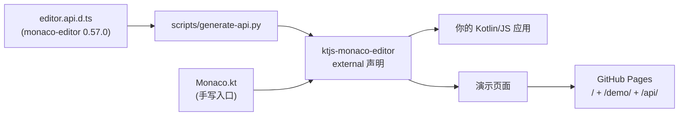

# 简介

`ktjs-monaco-editor` 是 [`monaco-editor`](https://www.npmjs.com/package/monaco-editor)（VS Code
使用的编辑器）的 Kotlin/JS 封装。它把该包自带的 ESM API——也就是 TypeScript 使用到的同一批对象——
包装成编译期会检查的 Kotlin `external` 声明，因此创建编辑器是带类型的调用，而不是 `dynamic`。

封装对应 `monaco-editor` `0.57.0`，声明由该包的声明文件生成：
[`editor.api.d.ts`](https://github.com/microsoft/monaco-editor/blob/main/src/editor/editor.api.d.ts)。
`scripts/generate-api.py` 读取这个文件并写出声明，所以跟随上游升级 = 升级 npm 版本 + 重新生成，
细节见[开发文档](https://github.com/shijianjs/ktjs-monaco-editor/tree/main/docs/development)。

**[在线演示](https://shijianjs.github.io/ktjs-monaco-editor/demo/)** ·
**[API 文档](https://shijianjs.github.io/ktjs-monaco-editor/api/)** —— 同一次部署里的三个产物。

## 封装覆盖了什么

| 部分 | 对应上游 |
| --- | --- |
| `Monaco.editor` | `monaco.editor`：创建编辑器、模型、主题、标记、分词 |
| `Monaco.languages` | `monaco.languages`：注册语言、provider 与 Monarch 语法 |
| `Monaco.Uri`、`Monaco.Position`、`Monaco.Range`、`Monaco.Selection`、`Monaco.KeyMod` | 上游以「值」导出的类：静态成员，以及 [`Monaco.uri`/`position`/`range`/`selection` 工厂](guide/api-overview.md) |
| `io.github.shijianjs.ktjs.monaco.{root,editor,languages,worker}` | 声明的类型，一个上游命名空间对应一个 Kotlin 包 |
| `Monaco.environment` | 全局 `MonacoEnvironment` 钩子，monaco 启动语言服务 worker 前会读它 |

`editor.api.d.ts` 里 monaco 写出的类型全部都有声明：300 个 interface、17 个 class、48 个 enum、
37 个 type alias、76 个函数与常量。少数刻意不做的声明及理由列在
[覆盖清单](https://github.com/shijianjs/ktjs-monaco-editor/blob/main/docs/development/coverage.md)。

## 这里的「封装」是什么

npm 包的类型在运行时会丢失，封装的意义是把它保留下来：

- TypeScript 的 `interface` 变成 Kotlin 的 `external interface`，成员名一致。运行时零开销，
  而 `unsafeJso<...> { }` 字面量赋值时会做类型检查。
- 字面量联合类型变成 `sealed external interface X` + 同名工厂 `X(String)` + 常量对象 `Xs`，
  也就是 `kotlin-wrappers` 的写法：`BuiltinThemes.vs` 运行时是 `String`，编译期是受检查的类型。
- 类型联合变成单个不透明 `external interface`，每个分支一个同名工厂；例如 `MarkerSeverity`
  上游是数字，这里每个取值都走同名工厂。
- `any`、`unknown`、`object` 变成 `JsAny`，是唯一不做静态收窄的成员，每一处都有注释说明原因。

## 下一步

- [快速开始](guide/getting-started.md)——依赖、第一个编辑器、monaco 需要的打包规则。
- [API 概览](guide/api-overview.md)——声明如何组织、怎么读。
- [演示](guide/demo.md)——在线页面调用了什么，每个调用展示了什么。

## 各部分如何拼起来

